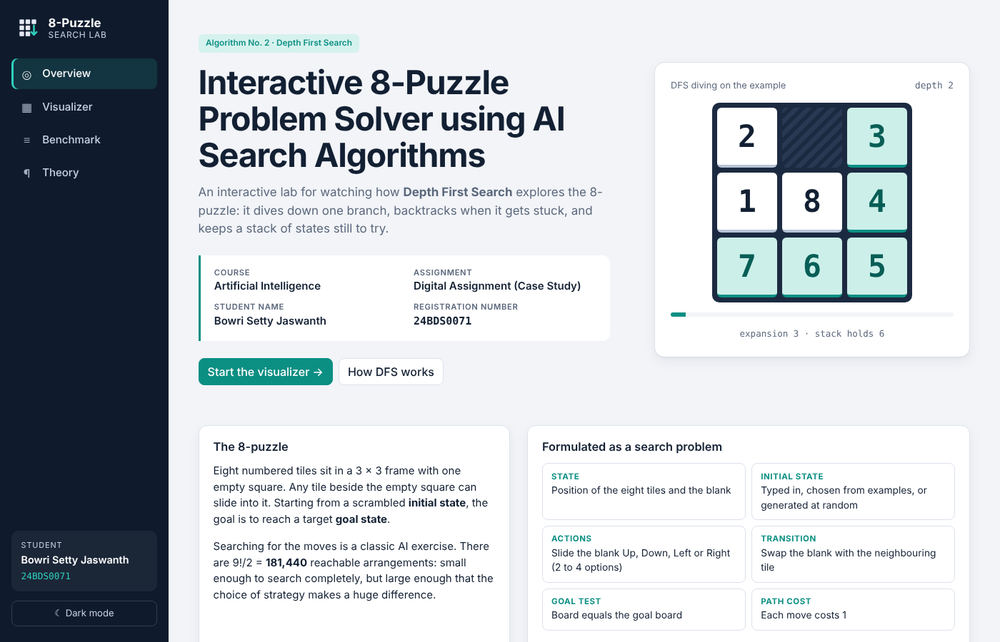
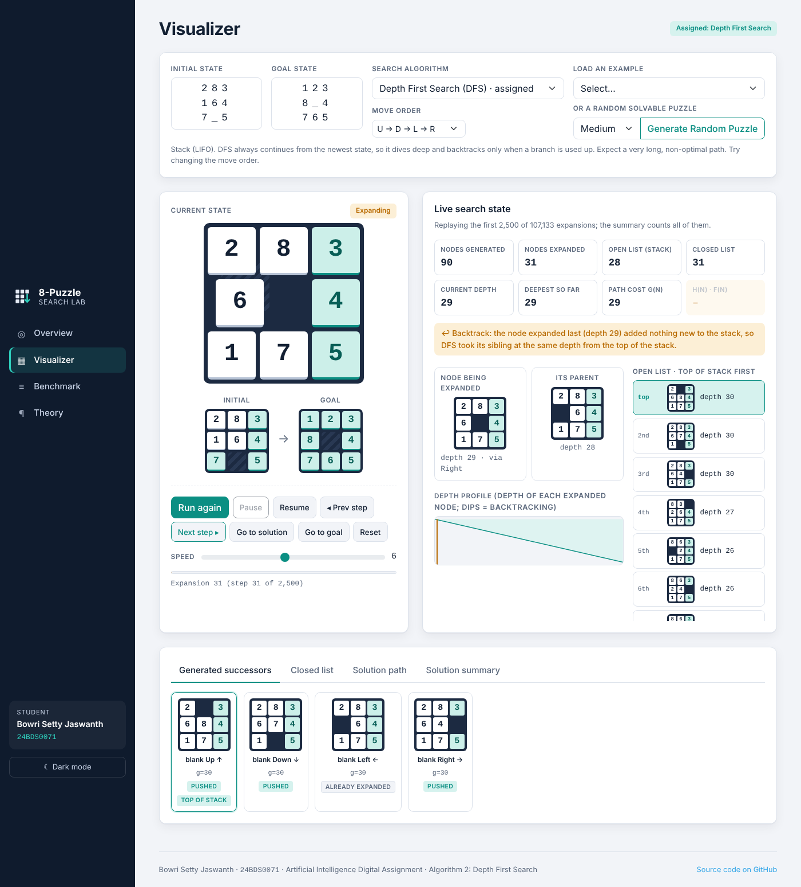
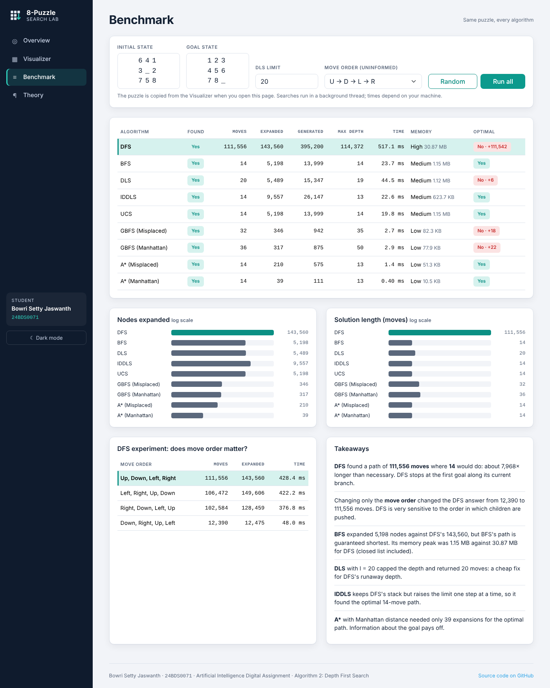
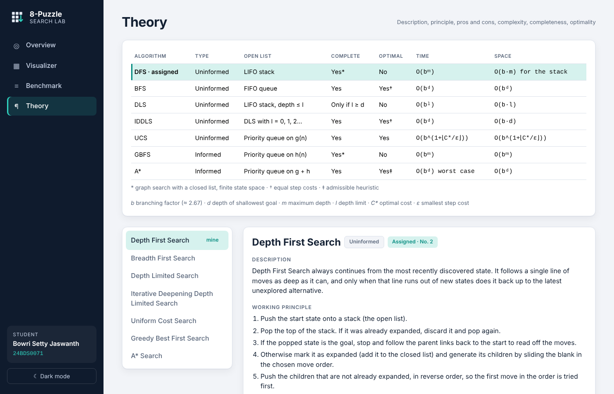
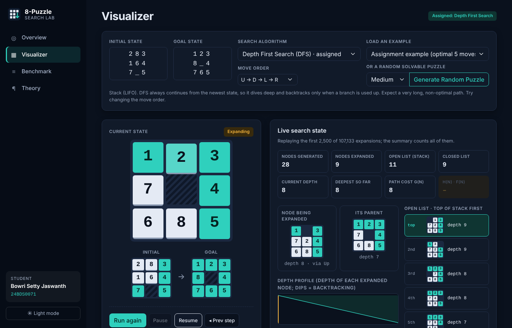
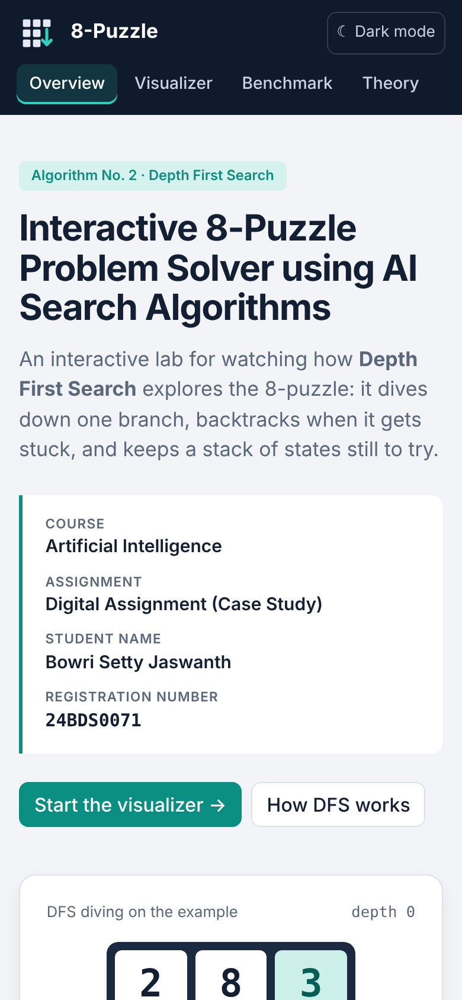

# 8-Puzzle Search Lab: Interactive 8-Puzzle Problem Solver using AI Search Algorithms

> Artificial Intelligence · Digital Assignment (Case Study) · **Algorithm No. 2: Depth First Search (DFS)**

| Student | Registration number | Course |
|---|---|---|
| **Bowri Setty Jaswanth** | **24BDS0071** | Artificial Intelligence |

- **Live demo (GitHub Pages):** https://jaswanthbowrisetty.github.io/AI-8Puzzle-Visualizer/
- **Repository:** https://github.com/jaswanthbowrisetty/AI-8Puzzle-Visualizer
- **Demonstration video:** [`assets/demo-video.mov`](assets/demo-video.mov)



## 1. Project description

**8-Puzzle Search Lab** is a browser application that treats the 8-puzzle as a state-space search problem and replays, one expansion at a time, how a search algorithm explores it. It is built around the assigned algorithm, **Depth First Search**.

For every DFS expansion the **Visualizer** shows:

- the **node being expanded** and its **parent**,
- the **successors generated** by sliding the blank, each labelled *pushed*, *pushed again* or *already expanded*, with the one that will be popped next marked **top of stack**,
- the **open list drawn as a stack** (top first) and the **closed list** (most recent first),
- counters for **nodes generated / expanded**, **open / closed list size**, **current depth**, **deepest depth so far** and **path cost g(n)**,
- a **backtracking banner** whenever DFS pops a node that is not deeper than the previous one,
- a **depth profile** chart of the depth of every expanded node.

When the goal is reached, the tiles animate along the **final solution path**. The **solution summary** reports found / not found, total moves, nodes generated and expanded, maximum depth, execution time, path cost and approximate memory. For DFS it also asks A* for the optimal length and states how many moves longer the DFS path is.

The other algorithms in the assignment list (BFS, DLS, IDDLS, UCS, GBFS, A*) share the same engine and appear on the **Benchmark** page. That page also runs a **DFS move-order experiment**, showing how much the DFS answer changes when only the order of the four moves changes.

### Requirement checklist

| # | Requirement | Where it is |
|---|---|---|
| 1 | Home page: course, title, student name, registration number, introduction, navigation | **Overview** page and side navigation |
| 2 | Puzzle input: enter initial and goal states; **Generate Random Puzzle** (always solvable) | Visualizer → setup panel (plus examples and a parity check) |
| 3 | Algorithm selection: BFS, DFS, DLS (depth limit), IDDLS, GBFS and A* (heuristic choice) | Visualizer → setup panel (UCS and DFS move order also available) |
| 4 | Show initial, goal and current state, generated successors and final path; **animated blank movement** | Visualizer → board stage and tabs |
| 5 | Live search process: current node, generated, expanded, open list, closed list, depth, parent, path cost; h(n), g(n), f(n) for GBFS/A* | Visualizer → *Live search state* |
| 6 | Solution summary: found / not found, moves, generated, expanded, max depth, time, path cost, memory | Visualizer → *Solution summary* tab |
| 7 | Comparison of all algorithms on the same puzzle | **Benchmark** page |
| 8 | Algorithm information: description, working principle, advantages, limitations, time/space complexity, completeness, optimality | **Theory** page |
| 9 | Controls: Run, Pause, Resume, Next step, Previous step, Reset, Speed | Visualizer → transport bar (+ *Go to goal*, *Go to solution*, keys ← → Space) |

## 2. Technologies used

| Layer | Technology |
|---|---|
| Structure | HTML5 (one page with hash routing: `#overview`, `#visualizer`, `#benchmark`, `#theory`) |
| Styling | CSS3: custom properties for light and dark themes, CSS-positioned sliding tiles, responsive grid |
| UI framework | **Bootstrap 5.3** (grid, form controls, tabs, pills) |
| Logic | JavaScript (ES6): all search algorithms written from scratch, no AI or search libraries |
| Graphics | Inline **SVG** (depth profile chart) |
| Performance | **Web Worker** keeps long searches off the main thread |
| Hosting | GitHub Pages |

## 3. Search algorithms implemented

States are 9-character strings read row by row, with `0` as the blank (for example `283164705`). A move slides the blank Up, Down, Left or Right and costs 1. Goal testing happens when a node is taken off the open list.

### Depth First Search (assigned)

```text
DFS(start, goal, order):
    open   ← stack containing Node(start)
    closed ← empty set
    while open is not empty:
        n ← open.pop()                      # newest node first (LIFO)
        if n.state in closed: continue      # an older duplicate copy
        if n.state = goal: return path(n)
        closed.add(n.state)
        children ← successors(n.state, order)   # e.g. Up, Down, Left, Right
        for c in reverse(children):              # so the first move is popped first
            if c.state not in closed:
                open.push(Node(c.state, parent = n, g = n.g + 1))
    return failure
```

- Code: `depthFirst()` in [`js/searches.js`](js/searches.js); the stack is `Frontier.Stack` in [`js/frontier.js`](js/frontier.js).
- **Graph search:** a closed list stops DFS from looping. A state may sit in the stack more than once; the copy pushed most recently is the one reached first, which keeps the expansion order truly LIFO.
- **Backtracking:** the recorder flags every expansion whose depth is not greater than the previous one, and the Visualizer displays it.
- **Move order** is configurable (U→D→L→R, L→R→U→D, R→D→L→U, D→R→U→L) because DFS's result depends on it.

**Worked example** (`283/164/7_5 → 123/8_4/765`, order U→D→L→R): DFS expands `283/164/7_5 → 283/1_4/765 → 2_3/184/765 → _23/184/765 → 123/_84/765`. At expansion 5 it **generates the goal** `123/8_4/765` and pushes it. Because "Down" is pushed last, `123/784/_65` is on top of the stack and DFS dives away from the goal. It only pops the goal again after **107,132 expansions**, returning a **99,663-move** path for a puzzle whose optimum is 5 moves. See [`docs/dfs-walkthrough.md`](docs/dfs-walkthrough.md).

### Summary of all algorithms

| Algorithm | Open list | Complete | Optimal | Time | Space |
|---|---|---|---|---|---|
| **DFS** (assigned) | LIFO stack | Yes (graph search, finite space) | **No** | O(bᵐ) | O(bm) stack; O(bᵐ) with closed list |
| BFS | FIFO queue | Yes | Yes (unit costs) | O(bᵈ) | O(bᵈ) |
| DLS | Stack, depth ≤ *l* | Only if *l* ≥ *d* | No | O(bˡ) | O(bl) |
| IDDLS | DLS with *l* = 0, 1, 2, … | Yes | Yes (unit costs) | O(bᵈ) | O(bd) |
| UCS | Priority queue on g(n) | Yes | Yes | O(b^(1+⌊C*/ε⌋)) | same |
| GBFS | Priority queue on h(n) | Yes (graph search) | No | O(bᵐ) | O(bᵐ) |
| A* | Priority queue on g(n)+h(n) | Yes | Yes (admissible h) | O(bᵈ) | O(bᵈ) |

## 4. Heuristics used

DFS itself uses no heuristic. GBFS and A* on the comparison page use:

| Heuristic | Definition | Notes |
|---|---|---|
| **h₁: Misplaced tiles** | number of tiles (not the blank) away from their goal square | admissible and consistent |
| **h₂: Manhattan distance** | Σ \|row − goalRow\| + \|col − goalCol\| over all tiles | admissible and consistent; h₂ ≥ h₁, so it dominates |

Example (`283/164/7_5` vs `123/8_4/765`): h₁ = 4, h₂ = 5.

**Solvability:** a move never changes the parity of the inversion count on a 3 × 3 board. Boards with different parity can't reach each other, and the app reports this before searching.

## 5. Screenshots

| Visualizer (DFS mid-search) | Benchmark |
|---|---|
|  |  |

| Theory | Dark mode | Mobile |
|---|---|---|
|  |  |  |

### Sample results (`641/3_2/758 → 123/456/78_`, optimal 14 moves)

| Algorithm | Found | Moves | Nodes expanded | Memory |
|---|---|---|---|---|
| **DFS (U→D→L→R)** | **Yes** | **111,556** | **143,560** | **High** |
| BFS | Yes | 14 | 5,198 | Medium |
| DLS (l = 20) | Yes | 20 | 5,489 | Medium |
| IDDLS | Yes | 14 | 9,557 | Medium |
| UCS | Yes | 14 | 5,198 | Medium |
| GBFS (Manhattan) | Yes | 36 | 317 | Low |
| A* (Manhattan) | Yes | 14 | 39 | Low |

**DFS move-order experiment (same puzzle):** U→D→L→R 111,556 moves · L→R→U→D 106,472 · R→D→L→U 102,584 · D→R→U→L 12,390. Changing only the move order changes the DFS answer by roughly 9×.

## 6. How to run the project

**Online:** open https://jaswanthbowrisetty.github.io/AI-8Puzzle-Visualizer/

**Locally:**
```bash
git clone https://github.com/jaswanthbowrisetty/AI-8Puzzle-Visualizer.git
cd AI-8Puzzle-Visualizer
python3 -m http.server 8080
# then open http://localhost:8080
```
Double-clicking `index.html` also works. Browsers block Web Workers on `file://`, so searches then run on the main thread.

**Using it:**
1. Open **Visualizer**. Type the initial and goal boards (`283 / 164 / 7_5`), load an example, or click **Generate Random Puzzle**.
2. Keep **Depth First Search** selected and choose a move order.
3. Press **Run**. Use **Pause / Resume / Prev step / Next step / Go to goal / Go to solution / Reset** and the **Speed** slider. Keys: ← → step, Space pauses or resumes.
4. Open the **Solution summary** and **Solution path** tabs. Click any board in the path to jump to it.
5. Open **Benchmark** to compare every algorithm and run the DFS move-order experiment.

**Tests:** `node tests/check.js`. It checks the board model and heuristics, and confirms that every algorithm returns a legal move sequence. It also confirms that BFS, UCS, IDDLS and A* agree on optimal lengths, that DFS paths are legal for all four move orders and never shorter than optimal, that DLS fails below the solution depth, and that the hardest instance needs 31 moves. 432 checks pass.

## 7. Project structure

```
AI-8Puzzle-Visualizer/
├── index.html          single page: overview, visualizer, benchmark, theory
├── css/lab.css         theme (light/dark), sliding tiles, layout
├── js/
│   ├── board.js        board model, successors, move orders, heuristics, parity, scramble
│   ├── frontier.js     Stack, Queue, PriorityQueue (binary heap)
│   ├── searches.js     DFS, BFS, DLS, IDDLS, UCS, GBFS, A* + step recorder
│   ├── worker.js       Web Worker wrapper
│   ├── theory.js       Theory page content
│   └── ui.js           views, animated boards, playback, benchmark, theory rendering
├── assets/             icon, demo video
├── images/             screenshots
├── docs/               DFS walkthrough, video script, deployment notes
├── tests/check.js      Node test-suite
└── README.md
```

## 8. Student details

- **Name:** Bowri Setty Jaswanth
- **Registration number:** 24BDS0071
- **Course:** Artificial Intelligence, Digital Assignment (Case Study)
- **Assigned algorithm:** No. 2, Depth First Search

## 9. References

1. Russell, S. & Norvig, P. *Artificial Intelligence: A Modern Approach*, 4th ed., Pearson, 2021. Chapter 3, “Solving Problems by Searching”.
2. Reinefeld, A. “Complete Solution of the Eight-Puzzle and the Benefit of Node Ordering in IDA*”, *IJCAI*, 1993.
3. Wikipedia, “15 puzzle”, on solvability and inversion parity: https://en.wikipedia.org/wiki/15_puzzle
4. Bootstrap 5.3 documentation: https://getbootstrap.com/docs/5.3/
5. MDN Web Docs: Web Workers, SVG, CSS custom properties: https://developer.mozilla.org/
6. IBM Plex Sans and IBM Plex Mono via Google Fonts (SIL Open Font License).

**Third-party resources:** Bootstrap 5 (MIT licence, loaded from the jsDelivr CDN) and Google Fonts (OFL). All search, heuristic and visualisation code is original. AI assistance (Claude) was used during development.
